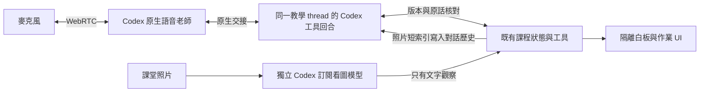

# Codex Live 訂閱語音

更新日期：2026-11-06。使用專案鎖定的 `@openai/codex 0.159.2`。

## 使用方式

在桌面課前畫面選「Codex Live」，再按「檢查訂閱並開始陪讀」。使用 ChatGPT 訂閱登入 Codex，可用專案的 [登入腳本](../../scripts/login-codex.ps1)。

可在課前或課中選擇 Codex 聲線。切換時重建語音連線，沿用主要教學對話、已提交白板和作業，並保留手動麥克風設定。文字求助也交同一教學對話，回答完成後經原生語音播報。

## 同一位主要老師，獨立圖片辨識

語音直接負責提示、解釋、訂正及延續話題，收到逐字稿時不再另跑一位文字老師。白板或作業需要操作時，由原生交接在同一主要教學 thread 呼叫受控工具。語音模型與內部工具模型可能不同；「同一 Codex」指同一個主要教學角色、課程脈絡與訂閱登入，並非保證底層模型相同。

看圖持有獨立 thread 與模型，原圖只交看圖角色。辨識結果提交後，程式把拍攝時間、完成時間及短引用寫入同一教學對話的歷史。老師需要細節時，用 `get_photo_observation` 依引用讀取有限長度的結果。背景更新沿用 `thread/inject_items`，照片完成時維持正常收音及播音。

新照片、關閉鏡頭、中斷、課程修改或說話者變更會撤銷過期的操作與證據。定向核對保留指定拍攝；需要操作白板時會重新核對照片與結果版本。

受控工具包括取得課程、照片核對、白板、作業清單、對話節奏與學習求助證據。白板支援文字／算式，也可使用原有隔離 HTML/CSS/JavaScript 顯示；會檢查學生可見內容。作業完成沿用原話與手動勾選規則，照片不直接證明整份作業完成；未知說話者不直接成為學生學習證據。重複工具回呼不重複提交，舊版本回呼會失敗。

兩種原生語音共用教學原則與跨堂背景。家長可選用短檢查，老師先詢問孩子意願，再把關鍵步驟交回孩子。Codex 的 `record_learning_attempt` 必須引用本次學生文字或語音轉錄，先存為待家長核對；不以模型自評作為已學會的證明。agy 沒有可核對語音逐字稿，只能以程式提供短引用的學生文字提議學習紀錄，經畫面確認後保存，或由家長補記。詳見 [教學使用與驗收](teaching-validation.md)。

課中更正學習資料後，Codex 將新背景寫入既有對話；同步失敗時停止語音並提示重連。agy 會受控重連以載入新背景，保留作業及手動麥克風設定。

## 訂閱與資料邊界

所有新模式的推論程序只匯入 ChatGPT 登入資料，移除儲存或環境中的 API 認證；檢查帳號類型為 `chatgpt`。主要老師及看圖都遵守此規則。課後整理在本機執行。CLI 狀態在該 Windows 帳號的私有目錄中暫存，結束時清除；不匯入使用者的設定、技能、外掛或對話歷史，不輸出憑證到介面或報告。

麥克風透過 WebRTC 直接送 Codex 語音服務；Python 只管理本機控制、工具與課程紀錄。語音轉錄與文字回覆不是逐字播放收據，資料與課後摘要明確保留這個限制。暫停期間的老師轉錄標示未播放；重新連線不把先前語音視為已完整聽到。接續課程恢復清單、方向與標明未核對播放的脈絡，重新取得照片與語音連線。

實測已確認 ChatGPT 認證且不提供 API Key 的連線可用。尚未實測帳號的實際額度扣除或價格，UI 的連接分鐘數只是本機估計，不是帳单或額度證明。原生 app-server 介面是實驗能力，服務端變更、帳號權限及額度可能影響可用性。參考 [官方 app-server 文件](https://learn.chatgpt.com/docs/app-server) 與 [官方語音說明](https://learn.chatgpt.com/docs/features/voice)。

## 驗證範圍

自動測試涵蓋課堂工具的版本驗證、照片索引、音訊停止與重連，以及兩種模式的桌面操作。測試使用合成學生及裝置。執行方式見 [參與開發](../../CONTRIBUTING.md)。

實體裝置的回音與自然插話、長時間課堂、真實斷線恢復及帳號額度扣除仍待驗收。
